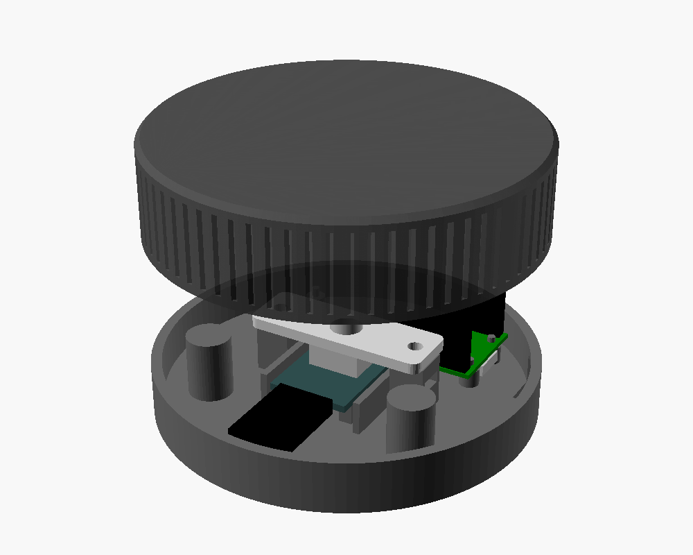
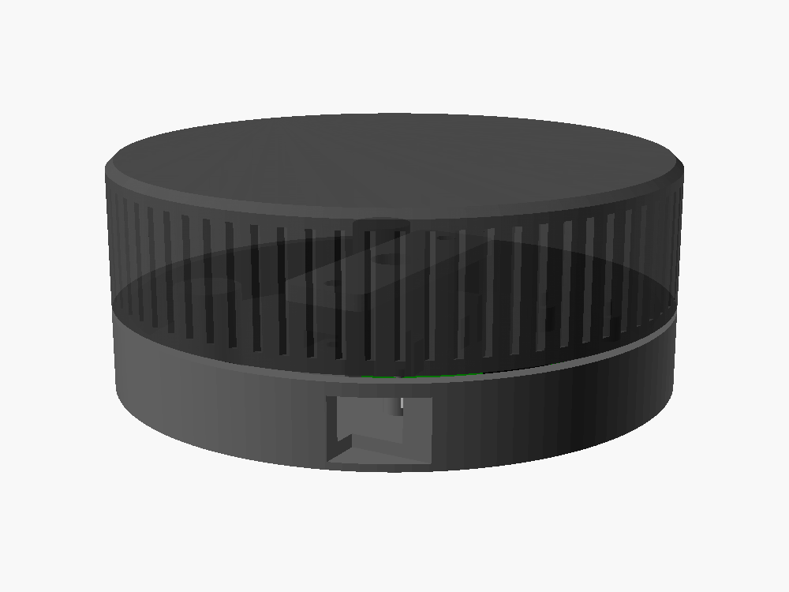

# Obudowa pokrętła (krążek)

Krążek Ø86 × 34,5 mm na **Raspberry Pi Pico H + moduł KY-040 + przewody dupont**, bez lutowania.
Kręcisz całą górną pokrywą, a klikasz, wciskając ją.

## Pliki do druku (`stl/`)

| Plik | Co to | Orientacja | Uwagi |
|---|---|---|---|
| `knob_test.stl` | **4 pierścienie próbne** na oś enkodera (numer = liczba nacięć) | jak w pliku | **drukuj najpierw** (ok. 10 min) |
| `knob_base.stl` | podstawa: dno, ścianka z otworem USB, słupki | dnem do stołu | podpory niepotrzebne |
| `knob_plate.stl` | płytka, do której przykręca się enkoder | płasko | |
| `knob_cap.stl` | obracana pokrywa z ryflowaniem | **wierzchem do stołu** (tak jest w pliku) | wierzch wyjdzie gładki od stołu |

Sugerowane ustawienia: PLA/PETG, warstwa 0,2 mm, 3 obrysy, wypełnienie 15–20%, bez podpór.

## Najpierw: pierścienie próbne

Nasuwaj pierścienie na oś KY-040 po kolei. Wybierz ten, który wchodzi **z wyraźnym oporem** i nie obraca się na osi:

| Nacięcia | Otwór w modelu | Ustaw `shaft_hole` |
|---|---|---|
| 1 | 6,20 mm | 6.2 |
| 2 | 6,35 mm | 6.35 |
| 3 | 6,50 mm | 6.5 |
| 4 | 6,65 mm | 6.65 |

Jeśli jeden jest za ciasny, a następny za luźny, weź wartość pośrodku. Jeśli nawet nr 4 jest za ciasny, zwiększaj dalej.
Jeśli żaden nie trzyma pewnie, ustaw `set_screw = true`: w piaście będzie śruba dociskowa M3,
a w boku pokrywy mały okrągły otwór, przez który się ją dokręca.

## Wymiary KY-040

Model jest ustawiony pod **Okystar KY-040 (HW-040)**, czyli gładką tuleję bez gwintu i nacięty wałek. Inne moduły mogą się różnić,
więc wtedy zmierz je suwmiarką i popraw sekcję `[KY-040]` na górze pliku `bulbsync_knob.scad`:

| Parametr | Okystar KY-040 | Co zmierzyć |
|---|---|---|
| `ky_pcb` | 18,5 × 26 × 1,6 | szerokość, długość i grubość płytki |
| `ky_enc_from_edge` | 9 | od środka osi do krótkiej krawędzi płytki **bez** pinów |
| `enc_body_h` | 5,75 | od płytki do miejsca, gdzie zaczyna się tuleja |
| `bushing_h` | 7 | wysokość tulei |
| `shaft_above_bushing` | 8,6 | ile osi wystaje ponad tuleję |
| `shaft_hole` | 6,2 | otwór na oś, dobrany pierścieniem próbnym nr 1 |

Jeśli coś się różni, zmień liczby w OpenSCAD (darmowy) i wygeneruj STL ponownie:
**F6** (render), potem **F7** (eksport STL). Wcześniej ustaw na górze pliku `part = "cap";` (albo `"base"`, `"plate"`, `"test"`).
Plik sam sprawdza, czy po zmianach wszystko się mieści, i wypisuje komunikat w konsoli, gdy coś koliduje.

## Potrzebne drobiazgi

- 2 × śruba **M3 × 10** + 2 × nakrętka M3 (płytka enkodera do słupków),
- podkładki **M10** jako obciążnik (nakładane na dwa słupki, do ok. 13 sztuk na słupek); możesz też przykleić klejem na gorąco inne ciężkie drobiazgi w wolnych miejscach na dnie,
- nóżki silikonowe albo mata antypoślizgowa na spód (żeby podstawa nie obracała się razem z pokrywą),
- (opcjonalnie, gdy `set_screw = true`) śruba M3 × 8 + nakrętka M3 do piasty.

## Składanie

1. **Nakrętki M3** wsuń w boczne kieszenie obu słupków.
2. **KY-040:** podłącz przewody dupont (zostaw je podłączone). Włóż moduł w **gniazdo na środku podstawy**:
   płytka leży na czterech podkładkach, między dwiema ściankami, osią do góry, pinami w stronę słupków na podkładki (patrz podgląd).
3. **Płytkę mocującą** nałóż otworem na tuleję enkodera i przykręć do słupków śrubami M3 × 10.
   Płytka dociska korpus enkodera od góry, więc moduł nie może się ruszyć. Słupki są celowo o 0,3 mm niższe
   (`plate_press`), żeby docisk był pewny. Jeśli enkoder i tak ma luz w pionie, podłóż pod płytkę kawałek taśmy
   albo zmniejsz `enc_body_h`.

   Jeśli Twój enkoder ma gwintowaną tuleję i nakrętkę, ustaw `bushing_threaded = true`, wtedy enkoder przykręca się nakrętką.
4. **Pico H** odwróć **do góry nogami** (pinami do góry), gniazdem USB w stronę otworu w ściance, i nałóż na cztery kołki.
   Podłącz przewody według schematu z głównego README (CLK → pin 4, DT → 5, SW → 6, GND → 3, + → 36).
   Pamiętaj, że po odwróceniu lewa i prawa strona Pico są zamienione. Kieruj się podpisami na spodzie płytki (GP2, GND, 3V3).
5. Ułóż przewody płasko, nałóż **podkładki** na słupki, przyklej **nóżki** pod spodem.
6. **Pokrywę** wciśnij na oś enkodera, aż piasta oprze się końcem osi o sufit pokrywy.
   Kliknięcie powinno być wyraźnie wyczuwalne, a pokrywa nie może ocierać o podstawę.
7. Podłącz kabel micro-USB przez otwór w podstawie.

Jeśli pokrywa ociera o podstawę, zwiększ `gap`. Jeśli kliknięcie nie działa (pokrywa opiera się, zanim zadziała przycisk),
sprawdź `shaft_above_bushing`: plik wypisuje „Luz pod piastą”, który powinien wynosić co najmniej 1,5 mm.
